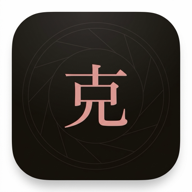
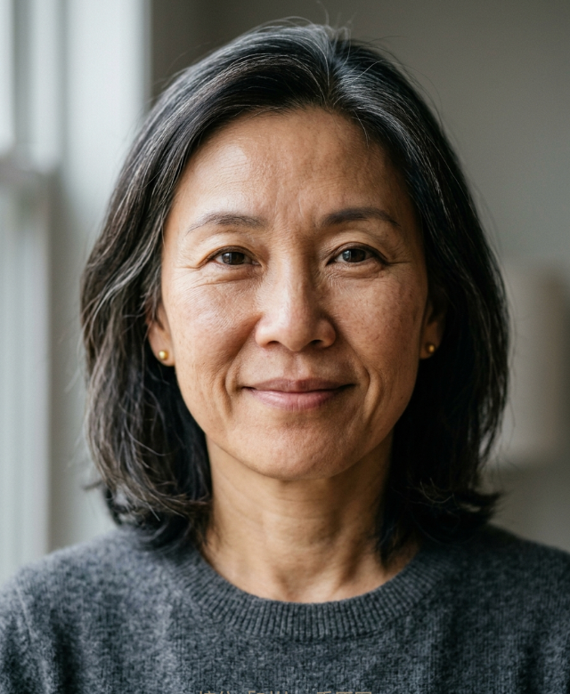

<p align="center"></p>
<h1 align="center">Porcelain</h1>
<p align="center"><b>On-device face retouching in your browser. Your photos never leave your device.</b><br>
Clone it, open your AI coding agent, and tune it into <i>your</i> beauty app.</p>

<p align="center"><a href="https://tian-9.github.io/porcelain/">▶ Try it live</a> — add it to your home screen and it installs as an offline app.</p>

| Before | After |
|---|---|
|  |  |

<sup>Demo portrait is AI-generated — not a real person. Settings: smooth 55 · brighten 30 · smile lines 60 · slim jaw 20 · cheeks 45.</sup>

## Why

Every mainstream retouch app wants your selfies on their servers. Porcelain is a single HTML file plus a bundled face-landmark model: no backend, no account, no analytics, no uploads. After the first load it works with networking off entirely.

## Features

- **Skin smoothing** with edge protection — pores and hair stay sharp, blemishes go
- **Smile-line (nasolabial fold) softening** — lifts only the crease shadow toward clean skin sampled from *both sides* of the fold, so skin texture survives
- **Slim jaw · slim cheeks · bigger eyes · slim nose** — landmark-guided liquify, tuned to stay subtle
- **Brighten, eye light, 6 filters** tuned for a clean, luminous aesthetic
- Pinch / scroll / double-tap **zoom** (toolbar stays put), hold-to-**compare**, one-tap glow-up
- **PWA**: installable, offline-capable, works on phone and desktop
- UI auto-switches **English / 中文**

## How it works

[MediaPipe Face Landmarker](https://ai.google.dev/edge/mediapipe/solutions/vision/face_landmarker) (WASM, bundled in `vendor/`, runs locally) pins 478 landmarks on the face. Everything else is one WebGL fragment shader:

- **Warping** (slim/eyes/nose) is inverse displacement sampling — a controlled funhouse mirror, fully reversible
- **Smoothing** mixes in a Gaussian-blurred layer, masked to skin polygons, with an edge-keep term and high-frequency re-add
- **Fold softening** builds a mask band from nose wing to mouth corner and lifts only pixels darker than neighboring clean skin (`max(col, sideRef)`) — a digital concealer that touches shadows, not texture

All GPU, real-time sliders, up to 2048px working resolution.

## Clone it, make it yours

This repo ships with a **Claude Code skill** (`.claude/skills/retouch-lab/`) and a `CLAUDE.md` codebase map. Clone it, open [Claude Code](https://claude.com/claude-code) (or any AI coding agent), and just say:

- *"Make max smoothing stronger"*
- *"Add a teeth-whitening slider"*
- *"My smile lines run lower — move the mask band down"*
- *"Add a warm sunset filter"*

Every tunable constant is documented with its file location and safe range. The agent can also run the app locally and verify changes visually using the built-in debug hooks.

## Run locally

```sh
git clone https://github.com/Tian-9/porcelain && cd porcelain
python3 -m http.server 8788   # any static server works
# open http://localhost:8788/index.html
```

No build step. No dependencies.

## Privacy

- Photos are decoded, processed and exported entirely inside your browser tab
- The only network requests are for the app's own code and one Google font; the service worker caches them, after which it runs offline
- Nothing is logged, stored or sent anywhere

## 中文说明

Porcelain（中文界面叫**克图**）是一个纯前端的本地美颜修图 App：磨皮（保毛孔）、美白、**法令纹淡化**（只提沟影不糊皮肤）、瘦脸、收颊、大眼、瘦鼻、亮眼、六款滤镜（清透白皙调性）。照片全程不出设备，加载一次后断网可用，手机浏览器里"添加到主屏幕"即可当 App 使用。

仓库自带 Claude Code skill：clone 之后打开 Claude Code，直接说"磨皮上限调狠一点 / 加个美牙滑杆 / 法令纹遮罩往下挪"，AI 会按 `CLAUDE.md` 里的参数地图改给你，并在本地起服务验证效果。

## License

MIT — do whatever makes you glow. ✨
